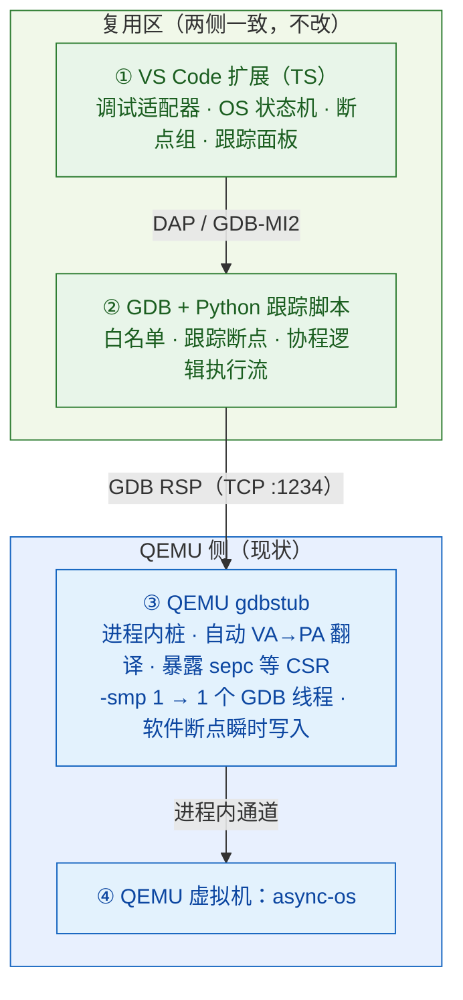
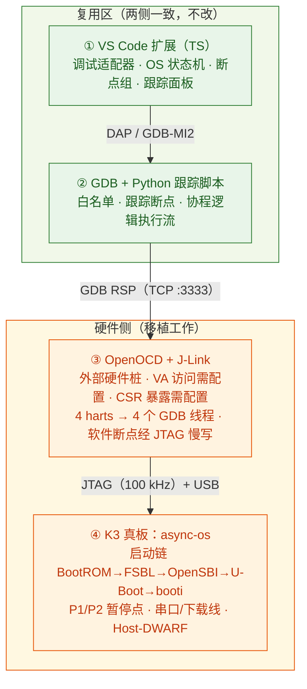

# K3 真板远程调试适配

- 状态：Draft
- 作者：Irissssaa611
- 讨论：详见本提案的 Pull Request。
- 关联设计：暂无
- 实现：`feat/k3-board-adapter` 分支

## 概述

async-debug 当前仅支持 QEMU 虚拟机调试。为了让调试器在真实硬件上可用——面向远程开发场景和线上实验平台——需要适配 K3（SpacemiT COM260，RISC-V 64，8 核）真板。调试链路为 JTAG + OpenOCD + GDB remote target，替代 QEMU gdbstub。本文档覆盖从系统架构到逐层实现的完整设计，目标是实现远程硬件调试。

## 问题与动机

### 当前局限

async-debug 的调试后端依赖 QEMU gdbstub，如果要移植到真实硬件上，核心差异集中在调试桩（stub）对寄存器、内存、单步和线程模型的语义上。

下面两张图按相同的四层结构画出 QEMU 与硬件两条链路。颜色约定：**绿色 = 复用区（两侧一致，不改）**，蓝色 = QEMU 现状，橙色 = 移植工作区。移植工作集中在下面两层（调试桩 + 目标）。

**QEMU 远程调试架构：**



**硬件（K3）远程调试架构：**



两图对照可见：①② 层逐字相同，移植不触碰 TS 和 Python 的业务逻辑。差异全部落在 ③ 层——同一个 GDB Remote Serial Protocol 接口背后，QEMU gdbstub 与 OpenOCD 对"读寄存器、读内存、单步、线程枚举"四类操作的响应语义不同（详见 §4.5）。④ 层则是真板特有的启动链与调试介入时机问题。


### 线上实验平台的前置依赖

线上实验平台上的 K3 调试器部署，依赖本提案的输出：
- 稳定的调试流程（脚本化、可复现）
- 清晰的设计文档（供平台集成方参考）
- 经过验证的地址布局和断点配置（内核态 + 用户态）

## 方案

### 1. 系统架构

调试器从 QEMU 的单进程模型迁移到 K3 真板的分布式模型，链路变为：

```
┌─ VS Code 扩展 (ardb) ──────────────────────────────────────────┐
│   调试适配器（TS）：状态机、断点组、launch 配置                    │
│   Async Inspector 面板：协程树、快照                              │
└────────────┬────────────────────────────────────────────────────┘
             │ GDB/MI 协议
┌─ gdb-multiarch + Python 跟踪脚本 ──────────────────────────────┐
│   白名单与地址表、CallSite 断点、影子栈、快照                      │
│   connect() 走 target-select remote :3333                       │
└────────────┬────────────────────────────────────────────────────┘
             │ GDB Remote Serial Protocol (TCP)
┌─ OpenOCD (:3333) ──────────────────────────────────────────────┐
│   翻译层：GDB 协议 ↔ JTAG 命令                                    │
│   配置：spacemit-k3.cfg（目标）+ jlink.cfg（接口）                  │
│   SECJTAG 解锁：irscan 0x98                                     │
└────────────┬────────────────────────────────────────────────────┘
             │ JTAG (100 kHz, via J-Link)
┌─ K3 COM260 真板 ───────────────────────────────────────────────┐
│   BootROM → Debug FSBL（复用 TF 卡槽引脚为 JTAG）                   │
│   → OpenSBI → U-Boot → booti → async-os                        │
│   CPU Debug Module：4 个硬件断点，执行触发                          │
└────────────────────────────────────────────────────────────────┘
```

板子另有两根线不在调试协议路径上，但启动流程必需：

- **USB-TTL 串口**（/dev/ttyUSB0）：BootROM/SPL/U-Boot 日志输出、U-Boot 命令下发。由状态机脚本驱动。
- **USB 下载线**：下载模式专用。BootROM 经它接收 FSBL（fastboot 协议），后续 SPL 经它接收 ITB。

### 2. 启动链与调试介入时机

板上启动链为 5 级接力：

```
BootROM → Debug FSBL → OpenSBI → U-Boot → booti → async-os
```

每级的职责和调试相关性：

| 阶段 | 职责 | 调试相关 |
|------|------|----------|
| BootROM | 芯片出厂固件，验签加载 FSBL | 无关。strap 脚决定进下载模式还是正常启动 |
| Debug FSBL | 初始化 DDR，把 TF 卡槽引脚复用为 JTAG | **关键**：JTAG 在此之后才通；非 debug 版 FSBL 不会启用 JTAG，必须用 debug 版 |
| OpenSBI | RISC-V 固件运行时服务（定时器、核间中断） | 无关。版本需与内核匹配 |
| U-Boot | 引导加载器：装载内核和 DTB 到内存，booti 跳转 | **P1 暂停点**：booti 前停在命令行 |
| async-os | 目标内核 | **P2 暂停点**：rust_entry 首条指令 |

#### 2.1 P1：booti 前暂停（准备窗口）

**时机**：U-Boot 完成内核和 DTB 装载后，停在提示符前。状态机触发暂停的条件是环境变量 `K3_PAUSE_BEFORE_BOOTI=1` 且 `/tmp/k3_pause_release_booti` 文件不存在。

**此时可做的事**：JTAG 已通、内核镜像已在内存地址 0x140000000、CPU 空闲。在此窗口内完成全部调试准备——启动 OpenOCD、F5 连接、设置断点和白名单、预埋 P2 触发。

**状态机实现**（`k3_boot_state_machine.py`）：状态机到达 `STATE_UBOOT_PROMPT` 时，检测到暂停条件满足，则清掉上次残留的 release 文件后打印 `[PAUSE] before booti` 并等待。外部 `touch /tmp/k3_pause_release_booti` 后继续执行 booti。

#### 2.2 P2：rust_entry 硬件触发（断链自停保险）

**机制**：K3 CPU 调试模块支持 execution trigger（硬件执行触发）。地址指向内核入口 `rust_entry`（虚拟地址 0xffffffc140015bce），内核第一脚踩中即自行冻结。

**触发预埋**：F5 连接时 launch 配置的 `autorun` 字段在 connect 成功后依次执行：

```
monitor halt                   # 冻结 CPU
monitor bp 0xffffffc140015bce 4 hw  # 设硬件执行触发（type=4）
monitor resume                 # 放行
```

也可手动用 gdb batch 命令预埋（见 §2.3 第 4 步）。

**P2 的设计理由**：booti 瞬间 J-Link USB 经常因板子上电浪涌掉线。掉线后 GDB 失去连接，但硬件触发写在 CPU 调试模块内——内核第一条指令踩中触发，CPU 自冻。重新插 USB、重新 F5 即可接管，无需重刷板子。没有触发时，内核跑到断点 ebreak 无人接管，直接 panic。

### 3. 调试流程（操作视图）

完整的一次 K3 真板内核态调试会话，共 7 步：

**第 0 步：准备**

- 接线确认：串口线（/dev/ttyUSB0）、USB 下载线、J-Link 均已连接
- 确认无旧调试会话残留（VS Code 停止所有会话）
- 开扩展开发宿主窗口：`code --new-window --extensionDevelopmentPath=/home/iris/data/async-debug /home/iris/data/async-os-original`

**第 1 步：板子进下载模式上电（物理操作）**

- TF 卡槽插调试卡，12 针排针 pin10 短接（焊线接地 → FORCE_RECOVERY strap → BootROM 进 USB 下载模式）
- 断电再上电。此时风扇不转是正常的——下载模式切断 3.3V 供电链

**第 2 步：终端 1——跑状态机**

```bash
rm -f /tmp/k3_pause_release_booti
cd /home/iris/data/async-debug/testcases/k3-async-os
K3_PAUSE_BEFORE_BOOTI=1 K3_ASYNCHOS_TIMEOUT=600 ./boot_golden_flow.sh --uart /dev/ttyUSB0
```

脚本自动完成：USB 下载 FSBL → 等 SPL → 等 OpenSBI → 等 U-Boot → fastboot 传内核和 DTB。看到 `[PAUSE] before booti` 即到位。

**第 3 步：终端 2——起 OpenOCD**

```bash
cd /home/iris/data/async-debug/testcases/k3-async-os
./start_openocd.sh
```

看到 `Examined RISC-V core; found 4 harts` 才算成功。**必须在 P1 之后启动**——起早了 JTAG 引脚还未复用（全 1），OpenOCD 扫描失败后拒绝后续连接。

**第 4 步：终端 3——预埋 P2 硬件触发**

```bash
gdb-multiarch -batch \
  -ex 'set confirm off' \
  -ex 'file /home/iris/data/async-os-original/apps/user_boot/user_boot_riscv64-k3.elf' \
  -ex 'target remote :3333' \
  -ex 'monitor halt' \
  -ex 'monitor bp 0xffffffc140015bce 4 hw' \
  -ex 'monitor resume' \
  -ex 'detach' -ex 'quit'
```

看到 `breakpoint set at 0xffffffc140015bce` 即成功。

**第 5 步：放行 booti**

```bash
touch /tmp/k3_pause_release_booti
```

U-Boot 执行 booti，内核启动，第一脚踩中 rust_entry 触发，CPU 冻住。

**第 6 步：F5**

运行和调试面板选 `K3 async-os (JTAG+OpenOCD)`，按 F5。扩展通过 `connect()` 走 `target-select remote :3333` 连接 OpenOCD。内核停在 rust_entry。

**第 7 步：收工**

顺序固定：VS Code 停止调试 → Ctrl+C 停 OpenOCD → 板子断电。不要在调试会话连着时直接拔电源。

### 4. 调试器适配层设计

本节描述 async-debug 代码侧为支持 K3 所做的改动。原则：**不破坏 QEMU 调试路径，所有改动有回归测试兜底**。

#### 4.1 attach 模式 QEMU 可选化

**现状**：`attachRequest` 强制要求 `qemuPath`/`qemuArgs` 并拉起 QEMU 终端（`gdbDebugSession.ts:265`）。

**改动**：launch 配置未提供 `qemuPath` 时跳过 QEMU 启动，直接连远程桩。现有 QEMU 配置不受影响。

实现要点：
- `gdbDebugSession.ts` 的 `attachRequest` 处理中增加 qemu 可选分支
- 仓库 mock 测试套件兜底——确保不带 qemu 的配置不破坏带 qemu 的现有路径

#### 4.2 launch 配置（K3 attach 模板）

新增 K3 的 launch 配置模板，风格为 attach（与分支现有 OS 调试一致）：

```json
{
    "type": "ardb",
    "request": "attach",
    "name": "K3 async-os (JTAG+OpenOCD)",
    "target": "localhost:3333",
    "kernel_memory_ranges": [
        ["0xffffffc000000000", "0xffffffffffffffff"]
    ],
    "user_memory_ranges": [
        ["0x0", "0x40000000"]
    ],
    "border_breakpoints": {
        "kernel_to_user": "taskctx::arch::riscv::TrapFrame::user_return",
        "user_to_kernel": "trampoline::task_api::user_task_top::{async_fn#0}",
        "hook": "trampoline::executor_api::init_user"
    },
    "autorun": [
        "monitor halt",
        "monitor bp 0xffffffc140015bce 4 hw",
        "monitor resume"
    ]
}
```

配置项说明：

| 字段 | 值 | 说明 |
|------|-----|------|
| `target` | `localhost:3333` | OpenOCD gdb 端口 |
| `kernel_memory_ranges` | `0xffffffc0...` 起 | K3 内核虚拟地址区间，与 QEMU 相同（phys-virt offset 固定） |
| `user_memory_ranges` | `0x0–0x40000000` | 用户态低地址区间，需真板实测校准 |
| `border_breakpoints` | 三个函数名 | 边界断点：驱动内核↔用户状态机；hook 断点：读用户程序名 |
| `autorun` | 三条 monitor 命令 | 连接后自动 halt、埋 P2 触发、resume |

#### 4.3 K3 地址布局

来自 `riscv64-k3.toml`（async-os-original 仓库平台配置）：

| 项 | 值 | 说明 |
|------|-----|------|
| 物理内存起始 | 0x102000000 | 底部 32 MB 为固件保留区 |
| 物理内存大小 | 约 8 GB | 至 0x300000000 |
| 内核加载物理地址 | 0x140000000 | U-Boot booti 的 kernel 参数 |
| 内核虚拟地址 | 0xffffffc140000000 | phys-virt offset: 0xffffffc000000000 |
| UART0 | 0xd4017000 | 串口 MMIO 基址 |
| CLINT | 0xe081c000 | 核间中断 + 定时器 |
| 定时器频率 | 24 MHz | K3 平台参数 |
| 用户态 heap | 0x3FA00000 | 来自链接脚本 |
| 用户态 stack top | 0x3FE00000 | 用户栈顶 |
| signal trampoline | 0x40000000 | 信号跳板 |

**地址判据**：调试器用 PC 地址区间区分内核态/用户态。内核区间 `0xffffffc000000000–0xffffffffffffffff`（与 QEMU 一致，phys-virt offset 固定）；用户区间约 `0x0–0x40000000`。

#### 4.4 Host-DWARF 身份对齐

板上内核以 release 构建运行（不带调试信息）。主机加载同一次构建的 ELF 提供符号和源码映射。

**构建侧**（async-os-original `feat/k3-port`）：构建脚本一次产出三样：

| 产物 | 用途 |
|------|------|
| `asyncos.bin` | 上板镜像，通过 fastboot 传到 K3 内存 |
| `asyncos.elf` | 主机加载，GDB `file` 命令载入，提供符号和 DWARF |
| `manifest.json` | ELF 的 sha256 + git commit + 关键源文件 sha256 清单 |

**校验侧**（`verify_artifacts.sh`）：attach 前执行 `--check` 模式——比对 manifest 中的 sha256 与当前 ELF 是否一致。不匹配则拒绝连接，防止符号错位导致断点失效。

**校验脚本**（`verify_k3_workspace.py`）：以 manifest.json 为输入，离线校验：
- ELF 文件存在且 sha256 匹配
- 关键源文件的 sha256 匹配（保证主机源码与构建时一致）
- git commit 一致（保证同一次构建，防止跨版本符号漂移）

#### 4.5 用户态协同跟踪：QEMU 路径复用与 K3 差异

**目标**：K3 真板上的内核态+用户态协同跟踪复用 QEMU OS 模式的同一套状态机和断点组机制。

**QEMU 路径的机制回顾**（已在 `docs/accepted_design/性能优化设计.md` §4 中详述）：
- 所有符号文件常驻，切换只做断点插拔
- 状态机在四个状态之间迁移：内核态 ↔ 内核单步到用户 ↔ 用户态 ↔ 用户单步到内核
- 边界断点（user_return、user_task_top）驱动状态迁移
- hook 断点（init_user）读用户程序名，决定切到哪个用户组

**K3 继承的部分**：上述机制全部复用——状态机、断点组、边界断点、hook 断点、符号常驻。QEMU gdbstub 和 OpenOCD 对 GDB 协议层而言是同一类"远程桩"（`target-select remote`），TS 侧和 Python 侧代码不需要区分。

**K3 特有的差异（用户态协同跟踪 bug 的可能来源）**：

1. **JTAG 慢链路下的单步时序**：QEMU 下特权级过渡单步每步约 1 ms，K3 下每步约 20 ms（JTAG 100 kHz + gdb 协议往返）。单步序列期间 J-Link 掉线会导致过渡处理中断。当前的线程锁定+静默机制已覆盖 all-stop 竞争，但 J-Link 掉线不在同一抽象层——GDB 侧看到的是一段时间内所有命令超时。
2. **硬件断点数量限制**：K3 CPU 调试模块仅支持 4 个硬件断点。用户态协同跟踪需要同时安装入口断点（PollEntryBP）、调用点断点（CallSiteBP）、边界断点——远超 4 个。QEMU 无此限制（虚拟断点不限数量）。解决方案：用软件断点（ebreak 指令替换）替代硬件断点做大量插桩，硬件断点仅保留给 P2 触发和边界断点。**用户态协同跟踪的当前 bug 很可能与此有关**——大量 PollEntryBP/CallSiteBP 用硬件断点插入，OpenOCD 在超过 4 个时静默失败或覆盖旧断点。
3. **release 构建的符号质量**：release 优化后函数边界信息不全（行表缺失）。QEMU 下已通过指令级单步降级处理（`exec-next-instruction` 回退），K3 下同样生效。但 release 优化可能将某些边界函数内联或优化掉——导致边界断点无效，状态机无法触发组切换。需用 K3 ELF 的符号表逐一核实四个边界函数的存在性和调用一致性（`user_return`、`user_task_top`、`init_user`、`rust_entry`）。

**用户态协同跟踪的修复路径**：

1. 先验证硬件断点 vs 软件断点策略——在 K3 上确认当前是否在用硬件断点做大量插桩
2. 确认四个边界函数在 K3 release ELF 中未被优化掉（`nm` + 反汇编核实）
3. 在 QEMU 上以 K3 地址布局 + attach 模式复现用户态协同跟踪，隔离问题是 K3 硬件侧还是调试器状态机侧
4. 单步 —— 从 P1（恢复样协程入口）开始逐步验证用户态跟踪链：白名单生成 → PollEntryBP 命中 → CallSiteBP 命中 → 快照输出

### 5. 脚本与工具链整理

当前 K3 工具链分散在 `testcases/k3-async-os/` 下，存在以下问题：
1. 状态机脚本（`k3_boot_state_machine.py`）与 bash 包装脚本（`boot_golden_flow.sh`）职责重叠
2. 日志文件（logs/）堆积了大量历史调试输出，未清理
3. OpenOCD 配置（`openocd/target/spacemit-k3.cfg`、`openocd/interface/jlink.cfg`）缺少注释说明每个参数的来源
4. `config/baseline.env` 与 `config/baseline.env.example` 重复

**整理目标**：

| 文件 | 整理动作 |
|------|----------|
| `boot_golden_flow.sh` | 保持为入口脚本；增加错误处理和 --help；固化通过验证的参数 |
| `k3_boot_state_machine.py` | 添加模块级文档字符串，注释每个状态的转换条件；提取硬编码的等待时间为常量 |
| `start_openocd.sh` | 保持简单；增加 J-Link 序列号指定（多 J-Link 环境） |
| `openocd/target/spacemit-k3.cfg` | 逐参数注释：transport、adapter speed、SECJTAG irscan 的出处 |
| `openocd/interface/jlink.cfg` | 注释接口参数 |
| `verify_artifacts.sh` | 与 `verify_k3_workspace.py` 合并或明确调用链 |
| `logs/` | 清理历史日志，只保留最近一次成功会话的日志作为参考 |
| `config/baseline.env.example` | 保留 example；删除 `baseline.env`（运行时生成） |
| `launch.json.example` | 移入 `.vscode/` 目录或文档内联 |

### 6. 代码侧待优化项

以下项目从 K3 开发记录和当前代码状态中提取，按优先级排列：

1. **硬件断点 vs 软件断点策略**（P0，阻塞用户态跟踪）：在 `mi2.ts` 或 Python 侧增加 Z0（软件断点）vs hw break（硬件断点）的显式切换。当前 GDB 默认对 `break` 命令使用软件断点，但 OpenOCD 在某些配置下会将所有断点路由到硬件——需在 attach 配置中显式指定。

2. **launch 配置中的地址硬编码**（P1）：`rust_entry` 地址（0xffffffc140015bce）固化在 launch 配置中。每次 async-os 重编译后该地址可能漂移。应从 ELF 符号表自动提取（`riscv64-unknown-elf-nm` → `rust_entry`），在 launch 配置生成时填入。

3. **JTAG 慢链路的探针安装策略**（P1）：QEMU 下全量插桩的探针安装耗时约 130 ms，K3 下 JTAG 每步约 20 ms——安装大量软件断点（ebreak 写入）的总耗时可能达到秒级。需测量 K3 上的首次探针安装耗时，必要时在 K3 路径做差异化策略（如减少 CallSiteBP 数量、优先使用地址表）。

4. **OpenOCD 连接健壮性**（P2）：J-Link USB 掉线后 OpenOCD 不会自动重连，需手动拔插 USB + 重启 OpenOCD。持续改进方向：`start_openocd.sh` 增加自动重试循环（检测到无设备时等待 2 秒重试，最多 5 次）；或者在 boot_golden_flow.sh 中增加 OpenOCD 存活检测。

5. **状态机日志结构化**（P2）：当前 `k3_boot_state_machine.py` 的日志是纯文本打印。改为结构化日志（每条记录带时间戳、状态名、事件类型），便于后续线上平台集成时上报状态。

### 7. 线上实验平台部署

完成本提案后，K3 调试器需部署到线上实验平台。涉及以下工作（本次提案覆盖设计，实施另立计划）：

- **远程串口代理**：线上平台的 K3 板子不在开发者本机。需将 UART 输出和 U-Boot 命令通道通过网络代理（如 `socat` 或 WebSocket 隧道），使 `boot_golden_flow.sh` 能通过 TCP 而非本地 `/dev/ttyUSB0` 操作串口。
- **远程 USB 下载**：fastboot 协议走 USB，线上平台需提供 USB-over-IP 或等效方案，让开发者的 `boot_golden_flow.sh` 能看到 K3 的 USB gadget 设备。
- **OpenOCD 远程端口转发**：OpenOCD 的 3333 端口需通过 SSH 隧道或 VPN 暴露给开发者本机的 VS Code。
- **工作区管理**：线上平台可能同时有多个开发者在不同 K3 板子上调试。需要板子→工作区的映射机制（板子 UID ↔ async-os-original 工作区路径 ↔ launch 配置）。

## 替代方案与取舍

**方案 1（采用）：JTAG + OpenOCD + GDB remote target**

当前采用的方案。复用 async-debug 现有的 attach 模式和 GDB MI2 协议栈，代码侧改动最小。代价：JTAG 慢链路（100 kHz），单次操作延迟高；硬件断点数量受限。

**方案 2：OpenOCD 直接 RPC 集成**

在 TS 侧直接调用 OpenOCD 的 TCL RPC 接口，跳过 GDB 协议层。优点：消除 GDB ↔ OpenOCD 的协议转换开销，可直接操作 JTAG 扫描链。缺点：需要重写 `mi2.ts` 的整个底层为 OpenOCD TCL 协议——现有 QEMU 路径和 K3 路径走两套完全不同的连接栈，维护成本极高。**不采用**。

**方案 3：使用 QEMU K3 用户态模拟 + gdbstub**

在 QEMU 上以用户态模拟方式跑 async-os 的 K3 构建产物，用 gdbstub 调试。优点：完全复用 QEMU 路径，零硬件依赖。缺点：用户态模拟与真板的时序行为偏差大到不可接受（中断延迟、DMA、MMIO 均不模拟），调试结果无法代表真板行为。**不采用**，仅保留为 CI 回归的辅助路径。

**其他已放弃的方向**：

- **GDB Inferior 多目标**（已查证不可行）：想用不同 Inferior 区分内核和用户程序，但 QEMU gdbstub 不支持，OpenOCD 同样不支持多 target 同时连接。
- **non-stop 模式**（远期选项）：QEMU gdbstub 不支持，OpenOCD + K3 调试模块的理论支持情况未知，待真板验证后决定。
- **新官方 FSBL（8 GB DDR）**（当前绕过）：SPL 在 fastboot 下载 ITB 后挂死，根因未确认（可能是 OpenSBI RPMI 轮询死等或 DTB 不兼容）。当前用旧 debug FSBL（4 GB DDR）绕过。

## 实现与集成

### 已完成（`feat/k3-board-adapter` 分支）

| 提交 | 内容 | 对应 § |
|------|------|--------|
| `5d6b36c` | attach 模式 QEMU 启动可选化 | §4.1 |
| `750b1f9` | 移植 K3 调试资产（OpenOCD 配置 + golden flow 状态机）并 async-os 化 | §2, §5 |
| `e0dee54` | K3 attach launch 配置模板（单核、含 K→U 边界） | §4.2 |
| `79b7a46` | Host-DWARF 工作区离线校验脚本 | §4.4 |
| `1c41e44` | stopAtConnect：connect 后 -exec-interrupt 暂停远程目标 | §2.2 |
| `ec36f43` | K3 状态机 booti 前暂停钩子（K3_PAUSE_BEFORE_BOOTI） | §2.1 |

**已验证通过**：硬件链打通（OpenOCD + J-Link 停住 CPU，GDB 读寄存器/内存）、内核态协程断点调试。

### 待完成

| 编号 | 任务 | 优先级 | 依赖 |
|------|------|--------|------|
| T1 | 修复用户态协同跟踪 bug（硬/软断点策略 + 边界函数核实） | P0 | 无 |
| T2 | 脚本整理与注释（§5 清单） | P1 | 无 |
| T3 | launch 配置地址自动提取（`rust_entry` 从 ELF 符号表读） | P1 | 无 |
| T4 | JTAG 慢链路探针安装耗时测量 + 差异化策略 | P1 | T1 |
| T5 | OpenOCD 连接健壮性（自动重试） | P2 | 无 |
| T6 | 状态机日志结构化 | P2 | 无 |
| T7 | 线上实验平台部署设计 | P2 | T1 |

### 影响的代码

- `src/gdbDebugSession.ts`：QEMU 可选化分支、launch 配置 K3 模板
- `src/OSStateMachine.ts`：状态机——复用，K3 路径无特殊改动
- `src/breakpointGroups.ts`：断点组切换——复用
- `async_rust_debugger/runtime_trace.py`：硬件断点策略（hw break vs sw break 显式切换）、K3 地址区间兜底
- `testcases/k3-async-os/`：全部脚本——整理、注释、清理
- `async-os-original`（外部仓库 `feat/k3-port`）：Host-DWARF 构建脚本

## 验证与证据

### 已完成的验证

- **硬件链测试**：OpenOCD + J-Link 成功枚举 RISC-V core（`Examined RISC-V core; found 4 harts`），GDB 能 halt/resume、读寄存器（`info registers`）、读内存（`x/10x <addr>`）
- **P1 暂停测试**：15+ 次真板会话（2026-11-18 logs/），状态机稳定在 booti 前暂停
- **P2 触发测试**：硬件触发预埋成功（`breakpoint set at 0xffffffc140015bce`），内核自冻在 rust_entry
- **内核态断点**：普通断点（`break <file>:<line>`）在 rust_entry 之后的内核路径可命中
- **内核态协程快照**：命中协程断点后，面板显示协程树（带 CID）
- **J-Link 掉线恢复**：掉线后重新插 USB + 重启 OpenOCD + F5 可接管，P2 触发使内核保持在 rust_entry

### 待完成的验证

- 用户态协同跟踪：从 P1 起完整走一遍——白名单生成 → 用户程序加载 → PollEntryBP 命中 → CallSiteBP 命中 → 快照输出用户协程链
- 边界函数在 K3 release ELF 中的存在性（`nm` 核实四个函数）
- 硬件断点数量超限行为的真板实测（OpenOCD 在 >4 个 hw break 时的表现）
- JTAG 慢链路下首次探针安装耗时（白名单全量插桩的 ebreak 写入耗时）
- 多次冷启动复现稳定性（目标：连续 3 次成功）

## 开放问题

1. **用户态协同跟踪的根因**：bug 在硬件断点策略、release ELF 边界函数优化、还是状态机逻辑？——T1 通过 QEMU attach 对照实验 + 硬件逐项排除来定位。
2. **新官方 FSBL（8 GB）的 SPL 挂起**：旧 FSBL（4 GB）稳定但 DDR 容量受限。新 FSBL 的 SPL 挂死是 ITB 兼容性（RCPU 固件/DTB）、OpenSBI 版本不匹配、还是 DDR 训练参数差异？——暂不阻塞，当前用旧 FSBL 继续。
3. **线上平台的远程串口方案**：socat TCP 隧道 vs WebSocket 代理 vs 平台现有基础设施？——需与平台方对接后确定。
4. **K3 SMP=2 调试**：当前设计全按 SMP=1。多核调试的 all-stop 语义在 OpenOCD + K3 上是否和 QEMU 行为一致？——不在本次范围，但设计中的单步序列锁定机制为多核做好了准备（状态机操作 GDB 线程号，不写死核数）。

## 决策与后续

等待评审。关键决策点：

- 用户态协同跟踪 bug 的修复方案（硬/软断点策略是否作为根因）
- 线上平台部署的时间和接口对接窗口
- 新 FSBL 的优先级（是否阻塞用户态协同跟踪？——当前判断不阻塞，旧 FSBL + SMP=1 够用）